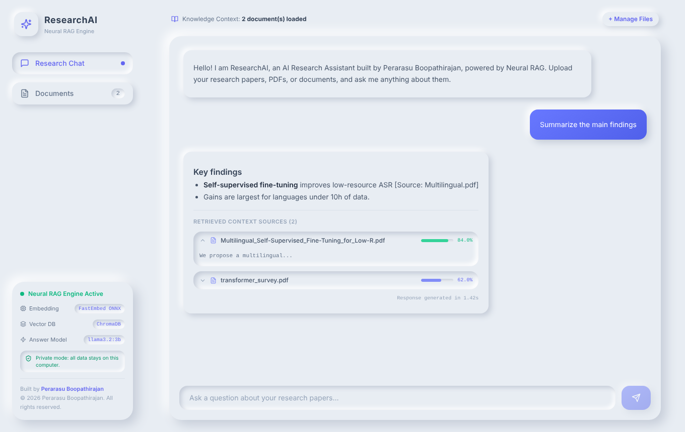
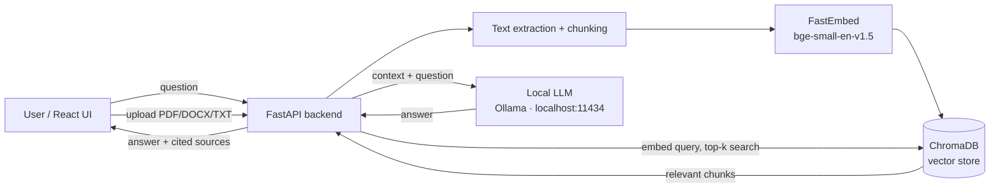
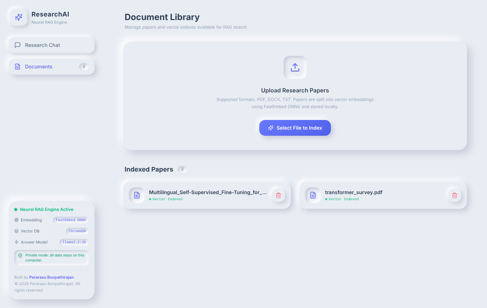

<div align="center">

# ResearchAI — Private Neural RAG Research Assistant

**Upload research papers. Ask questions. Get cited answers — 100% on your own machine.**

Created by **Perarasu Boopathirajan** · © 2026 · All rights reserved



</div>

---

## Why ResearchAI?

Most "chat with your PDF" tools send your documents to a third-party AI API.
ResearchAI is built **security-first**: retrieval *and* answer generation run on a
**self-hosted model**, so confidential papers, internal reports and questions
**never leave the computer**. No API key, no per-token cost, works offline.

## Features

- 📄 **PDF, DOCX, TXT ingestion** with sentence-aware overlapping chunking
- 🔎 **Semantic search** — FastEmbed (ONNX, CPU-only) + ChromaDB vector store
- 🔒 **Self-hosted answers** — local LLM served by Ollama (default), optional Groq cloud mode
- 📚 **Cited answers** with per-source similarity scores and expandable source passages
- 🛡️ **Hardened API** — filename sanitisation, file-type allow-list, restricted CORS, localhost-only binding
- 🎨 **White neumorphism UI** built with React, Vite and Tailwind CSS

## Architecture



Everything in this diagram runs on your machine.

| Layer | Technology |
|---|---|
| Frontend | React 18, Vite, Tailwind CSS, lucide-react |
| Backend | FastAPI, Uvicorn, Pydantic |
| Embeddings | FastEmbed (ONNX) — `BAAI/bge-small-en-v1.5` |
| Vector DB | ChromaDB (persistent, cosine similarity) |
| Answer model | Ollama (`llama3.2:3b` by default) · optional Groq |

## Getting started

**Requirements:** Python 3.10 or 3.11 · Node.js 18+ · [Ollama](https://ollama.com) · ~8 GB RAM

### 1. Local model

```bash
# install Ollama from https://ollama.com, then:
ollama pull llama3.2:3b
```

### 2. Backend

```bash
cd backend
python -m venv venv
# Windows: venv\Scripts\activate    macOS/Linux: source venv/bin/activate
pip install -r requirements.txt
cp .env.example .env          # Windows: copy .env.example .env
python main.py                # API on http://127.0.0.1:8000  (docs: /docs)
```

The embedding model (~130 MB) downloads once on first start; after that everything works offline.

### 3. Frontend

```bash
cd frontend
npm install
npm run dev                   # open http://localhost:5173
```

## Configuration (`backend/.env`)

| Variable | Default | Description |
|---|---|---|
| `LLM_PROVIDER` | `local` | `local` = self-hosted Ollama (private) · `groq` = cloud API |
| `LOCAL_MODEL` | `llama3.2:3b` | Any Ollama model, e.g. `qwen2.5:7b`, `mistral` |
| `OLLAMA_URL` | `http://localhost:11434` | Ollama server address |
| `GROQ_API_KEY` | – | Only needed when `LLM_PROVIDER=groq` |
| `HOST` / `PORT` | `127.0.0.1` / `8000` | API binding (localhost-only by default) |
| `ALLOWED_ORIGINS` | `http://localhost:5173` | Frontends allowed to call the API |

## API

| Method | Endpoint | Description |
|---|---|---|
| `POST` | `/api/upload` | Upload and index a document |
| `GET` | `/api/documents` | List indexed documents |
| `DELETE` | `/api/documents/{id}` | Remove a document from the index |
| `POST` | `/api/query` | `{ "query": "...", "top_k": 4 }` → answer + sources |
| `GET` | `/api/health` | Service and model status |

## Screenshots

| Research chat | Document library |
|---|---|
|  |  |

## Author

**Perarasu Boopathirajan** — design, development and architecture.

## License

Copyright © 2026 Perarasu Boopathirajan. All rights reserved. See [LICENSE](LICENSE).
